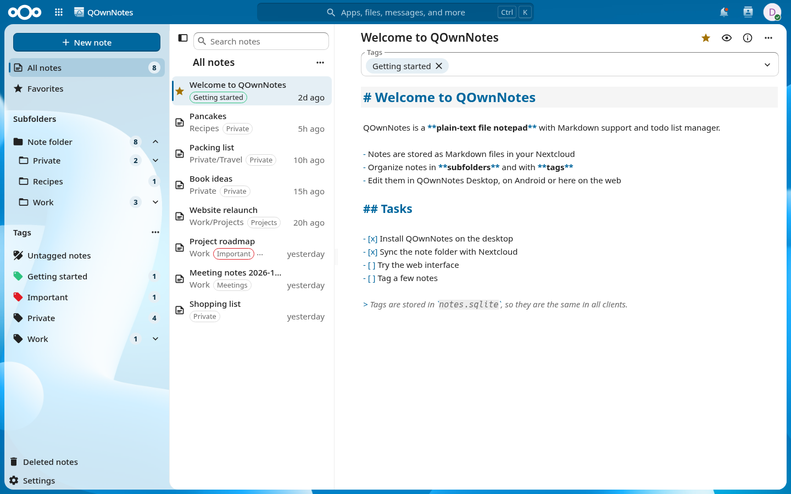

# QOwnNotes for Nextcloud

[Changelog](CHANGELOG.md) |
[Issues](https://github.com/qownnotes/qownnotes-nextcloud/issues) |
[API documentation](docs/api/README.md) |
[Migration guide](docs/migration.md)

QOwnNotes for Nextcloud lets you view and edit the notes of your [QOwnNotes](https://www.qownnotes.org) note folder in the Nextcloud web interface, including note subfolders and the tags stored in the note folder's `notes.sqlite`.

It also provides the server APIs for the [QOwnNotes desktop app](https://www.qownnotes.org) (note versions and trash) and the [QOwnNotes Android app](https://github.com/qownnotes/qownnotes-android) (a Nextcloud Notes API compatible note API), and replaces the QOwnNotesAPI app and, for QOwnNotes Android, the Nextcloud Notes app.



## Features

- Notes stay plain Markdown files in your Nextcloud, organized in note subfolders like in QOwnNotes Desktop
- Tags with hierarchy and colors, read from and written to the note folder's `notes.sqlite`, so they are the same in QOwnNotes Desktop, Android and on the web ([details](docs/notes-sqlite.md))
- Web interface with note list, subfolder tree, tag tree and filters, Markdown editor with preview, conflict handling, versions and deleted notes
- Dashboard widget, unified search (also by tags), link previews and "Open in QOwnNotes" in the Files app
- [Notes API 1.4](docs/api/notes-api.md) for QOwnNotes Android and the [QOwnNotes API](docs/api/qownnotes-api.md) for QOwnNotes Desktop and Android
- API-only mode: administrators can disable the web interface and only provide the APIs

Requirements: Nextcloud 32 to 35, PHP 8.2 to 8.5, and the PHP extension `pdo_sqlite` for tags.

## Installation

The first app store release is still pending. For now, use the [git installation](#from-the-git-repository). Once published, install **QOwnNotes** from the Nextcloud app store (category "Office"), or with:

```bash
occ app:install qownnotes
```

Users who switch from the QOwnNotesAPI or Nextcloud Notes app should read the [migration guide](docs/migration.md).

### From the git repository

```bash
git clone https://github.com/qownnotes/qownnotes-nextcloud.git apps/qownnotes
cd apps/qownnotes
npm ci && npm run build
occ app:enable qownnotes
```

## Markdown editor

Edit mode highlights headings, inline formatting, links, task checkboxes, Markdown markers and comments.
Fenced code blocks with a language label (for example, `js`, `python` or `php`) also get syntax highlighting in the editor and the preview, with colors for light and dark themes; language support is loaded on demand.

Press **Ctrl+F** to search in the note: Enter and Shift+Enter jump between the matches, the buttons in the search field match case, whole words or regular expressions, and the arrow on the left shows the replace field.

Press **Ctrl+Space** with the cursor on a task line to check or uncheck its checkbox (`- [ ]` / `- [x]`).
This also works for nested tasks and tasks in blockquotes or numbered lists, and can be undone like a normal edit.

## Live preview

In **QOwnNotes settings → Editor**, enable **Show preview beside the editor** and save.
The Markdown preview appears on the right and updates as you type, without waiting for autosave.
Use the **Preview** button to hide or show it. On narrow screens, the preview appears below the editor.
The editor and the preview scroll together like in QOwnNotes Desktop, and switching between them keeps the position.
This preference is remembered in the current browser only.

## API-only mode

Disable the web interface in the admin settings (section "QOwnNotes"), or with:

```bash
occ config:app:set qownnotes ui_enabled --value=no
```

The navigation entry, the web interface and all integrations (dashboard, search, link previews, Files action) disappear. The APIs and the capabilities keep working.

## Documentation

- [API overview](docs/api/README.md): base URL, authentication, capabilities and errors
- [Notes API](docs/api/notes-api.md) and [QOwnNotes API](docs/api/qownnotes-api.md)
- [Tags and `notes.sqlite`](docs/notes-sqlite.md)
- [Migration guide](docs/migration.md)
- [Planning document](docs/plan.md) and [release process](docs/release.md)

## Development

The development environment is provided by [devenv](https://devenv.sh) (`direnv allow` or `devenv shell`).

```bash
composer install
npm ci
npm run build          # build the web interface into js/ (or `npm run watch`)
just lint-php          # syntax, code style, static analysis and unit tests
just lint-js           # ESLint and JavaScript unit tests
just vm-test-version   # NixOS VM test against a single Nextcloud version (default: 34)
just vm-test           # NixOS VM test against all supported Nextcloud versions
just release-check     # validate release metadata and packaging inputs (no credentials needed)
just sign-app          # signed release archive in build/ (see docs/release.md)
just screenshots       # app store and README screenshots in docs/screenshots/ (docker dev server)
```

The VM tests use the git-tracked files, so add new files with `git add` before running them.

A Nextcloud development server with the app is in [docker/](docker/README.md), the Playwright end-to-end tests in [tests/e2e/](tests/e2e/README.md).

## License

AGPL-3.0-or-later, see [COPYING](COPYING).
